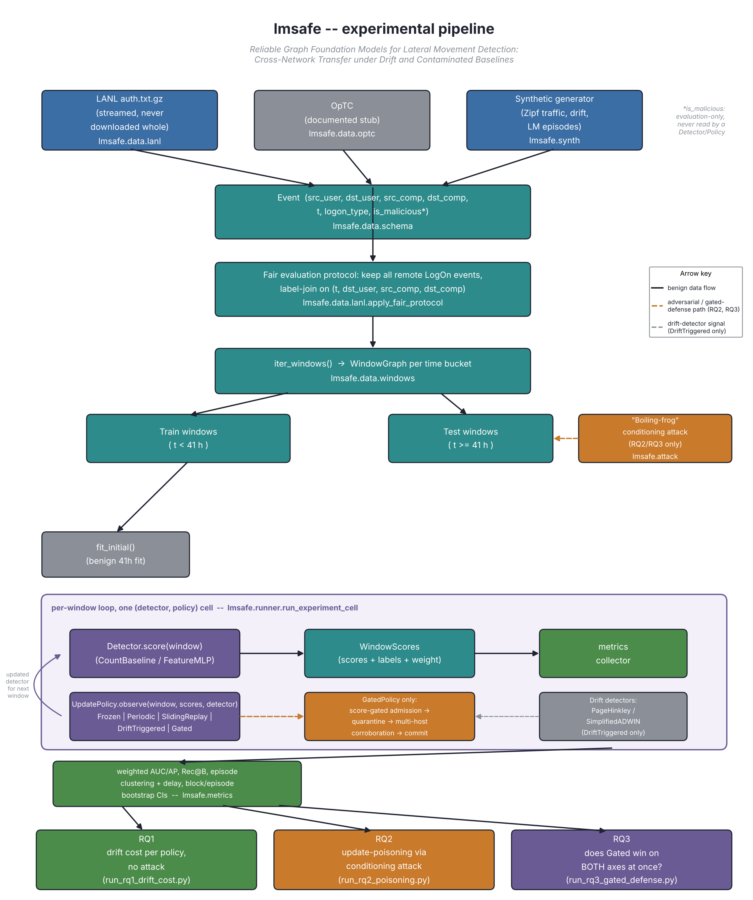

# lmsafe — Safe Continual Updating for Lateral-Movement Detection

Research code accompanying:

> **Reliable Graph Foundation Models for Lateral Movement Detection: Cross-Network Transfer under Drift and Contaminated Baselines**

This package treats the *updating mechanism* of a lateral-movement (LM) detector as part of its attack surface, not just its training algorithm. A detector trained once and frozen degrades as the network legitimately changes ("drift"); a detector that keeps retraining on recent traffic to track that drift can be slowly poisoned by an attacker who seeds low-volume "conditioning" traffic before the real attack step. This package builds the experimental harness that measures both failure modes side by side, on the same detectors, the same metrics, and the same fixed alert budget — and implements a proposed defense (**Gated**) designed to avoid both at once.

## Research questions

| | Question | Script |
|---|---|---|
| **RQ1** | How much detection quality does each update policy lose to *benign* drift alone (no attacker), and how fast does it recover? | `scripts/run_rq1_drift_cost.py` |
| **RQ2** | How much does an adaptive attacker degrade each policy by injecting low-volume "boiling-frog" conditioning traffic before the real lateral-movement step? | `scripts/run_rq2_poisoning.py` |
| **RQ3** | Does the proposed **Gated** policy recover RQ1's drift-tracking benefit *without* reopening RQ2's poisoning gap — at the same fixed alert budget as the naive policies? | `scripts/run_rq3_gated_defense.py` |
| **Cross-network transfer** | Does pretraining `GraphFoundationDetector` on one network's benign traffic improve lateral-movement detection on a *different* network with a disjoint host population, versus training on the target network alone? | `scripts/pretrain_foundation_model.py` + `scripts/run_cross_network_transfer.py` |

## Pipeline



*(regenerate with `python docs/make_architecture_diagram.py`; the figure is drawn in matplotlib so it stays in sync with the code it documents — see that script's own docstring)*

Every data source — real LANL, real OpTC, or the synthetic generator — is adapted into one shared `Event` representation (`lmsafe/data/schema.py`). From there, the pipeline is dataset-agnostic: a fair labeling protocol, a fixed 41-hour train/test split, fixed-length window graphs, then one shared experiment loop (`lmsafe/runner.py`) that scores each test window with a `Detector`, hands the result to an `UpdatePolicy`, and records every metric the paper reports.

## Package layout

```
lmsafe/
  __init__.py          research framing + module map (also reproduced above)
  config.py            central constants (time cutoffs) and LanlConfig/SynthConfig dataclasses
  data/
    schema.py           the Event dataclass shared by every data source; ground-truth boundary
    lanl_stream.py       dependency-free streaming reader for the real LANL .txt.gz files
                          (never downloads a file whole; the signed link is read at runtime only)
    lanl.py              fair evaluation protocol: label join, remote-LogOn filter, train/test split
    optc.py              real OpTC FLOW-event reader, schema-confirmed against an actual
                          ecar-bro sample; IP-to-host resolution, no red-team label join yet
    windows.py           groups events into fixed-length WindowGraphs
  synth.py              synthetic auth-log generator: Zipf traffic, population growth ("drift"),
                        injectable lateral-movement episodes with known ground truth
  detectors/
    base.py              the Detector interface (fit / score / clone_fresh / state_summary)
    count_baseline.py    Laplace-smoothed edge-frequency anomaly score (no torch)
    feature_mlp.py        small inductive torch MLP over per-host structural features
                          (never per-node identity, to stay inductive across new hosts)
    rw_gnn.py              GraphFoundationDetector: feature_mlp's inductive per-host features
                          plus one round of GraphSAGE-style neighborhood aggregation, trained
                          self-supervised, with weights that can be pretrained on one network
                          and transferred (zero-shot or fine-tuned) to a different one -- the
                          "graph foundation model" piece of the title; see its module docstring
                          for the precise, deliberately modest scope claimed by that name
  drift.py              PageHinkley and SimplifiedADWIN concept-drift detectors (trigger updates;
                        never used as the anomaly score itself)
  policies.py           the five update policies: Frozen, Periodic, SlidingReplay, DriftTriggered,
                        Gated (the proposed defense)
  attack.py             the "boiling-frog" conditioning-attack injector, offline/evaluation-only
  metrics.py            weighted AUC/AP, Rec@B, episode clustering + detection delay, two
                        time-aware bootstrap CIs (block bootstrap, episode bootstrap)
  factories.py          name -> class lookups used by YAML configs and the RQ scripts

scripts/
  run_rq1_drift_cost.py       RQ1: drift-strength sweep, 5 policies, fixed episode set
  run_rq2_poisoning.py        RQ2: one hand-placed target episode, clean vs. conditioned
  run_rq3_gated_defense.py    RQ3: 2x2 (drift x conditioning), the headline result
  run_experiment.py           generic YAML-driven runner -- the one script meant to point at
                               real LANL/OpTC data (every other script is a synthetic demo)
  fetch_lanl_window.py        small CLI for a Colab smoke-test of the LANL link + caching windows
  pretrain_foundation_model.py  pretrain GraphFoundationDetector on one network (synthetic or a
                               cached LANL window pickle), save the checkpoint for transfer
  run_cross_network_transfer.py  scratch vs. zero-shot vs. fine-tuned on a second, disjoint
                               network -- the cross-network-transfer experiment itself

configs/                 example YAML configs for run_experiment.py (synthetic + LANL dev/full)
docs/                    this figure + the script that generates it
tests/                   132 tests (pytest); see "Testing" below
results/                 output of the last run of each script (CSV + PNG)
```

## Installation

```bash
pip install -e .
```

Pulls in `numpy`, `pandas`, `scikit-learn`, `torch`, `pyyaml`, `matplotlib`. CPU-only `torch` is enough — `FeatureMLPDetector` is a small per-host MLP, not a GPU-scale model.

## Quick start (synthetic data, no network, no credentials)

```bash
python -m pytest tests/ -q                       # 92 tests, ~6s
python scripts/run_rq1_drift_cost.py              # -> results/rq1/
python scripts/run_rq2_poisoning.py               # -> results/rq2/
python scripts/run_rq3_gated_defense.py           # -> results/rq3/
python scripts/run_experiment.py configs/synthetic_quick.yaml
```

Each RQ script prints a per-policy table and writes a CSV + PNG figure to `results/<rq>/`. These are genuine, non-cherry-picked runs on synthetic data with a fixed random seed, used throughout development to validate the harness end-to-end before spending any LANL streaming budget. A representative pattern from the current code (your own run will match, since the seeds are fixed):

- **RQ1** — every policy's AP degrades monotonically as injected drift strength increases (e.g. `frozen`'s AP drops from ~0.0054 at `drift=0.0` to ~0.0023 at `drift=1.0`); `periodic`/`sliding_replay`/`gated` degrade more slowly than `frozen`, because they retrain.
- **RQ2** — under the conditioning attack, the naive retraining policies' target-hop rank fraction jumps from `0.00` (clean) to `0.24–0.37` (conditioned) — the attack measurably hides the first hop of the real attack from them. `frozen` and `gated` both stay at `0.00`.
- **RQ3** — the 2×2 grid shows `gated` matching or beating the best naive policy's AP under benign drift *and* staying at `hop_rank_frac = 0.000` under conditioning in every cell, including the hardest one (`drift=strong` **and** `conditioning=on`), where every naive policy's rank fraction jumps to `0.60`–`0.625`. This is the paper's central claim, reproduced on synthetic data.

## Running on real data (LANL / OpTC)

This sandbox cannot reach LANL's network, so real-data runs happen on your own machine or Colab notebook.

1. Get a signed download link from <https://csr.lanl.gov/data/cyber1/> (registration required). The link is a **temporary credential** — it is read once at runtime via the `LMSAFE_LANL_BASE_URL` environment variable (or an interactive, hidden `getpass` prompt if unset) and is never written to a config file, logged, or printed. See `lmsafe/data/lanl_stream.py` for the exact mechanism.
2. Smoke-test the link and cache a windowed slice:
   ```bash
   export LMSAFE_LANL_BASE_URL='<the signed link>'
   python scripts/fetch_lanl_window.py peek --file redteam --n 5
   python scripts/fetch_lanl_window.py redteam --out redteam.csv       # expect 749 rows
   python scripts/fetch_lanl_window.py build-cache --end-s 2592000 \
       --out lmsafe_cache/lanl_dev_windows.pkl
   ```
   Both `build-cache` above and `run_experiment.py`'s own LANL loader checkpoint the growing window cache atomically every `checkpoint_every` (default 24) test windows, not only once at the very end — a multi-hour real stream that gets interrupted (Colab disconnect, Ctrl+C, a dropped connection) still leaves a complete, loadable partial result on disk instead of nothing. **This does not auto-resume the network stream**: re-running with an existing cache file loads it as-is and treats it as final, so a true complete run requires deleting the cache file first. `stream_auth_events` also runs a raw-bytes prefilter before decoding/constructing an `Event` for each line, skipping that work entirely for the ~63% of real LANL rows the fair protocol would discard anyway — a provably-equivalent, test-covered optimization (see `tests/test_lanl_labels.py`) measured at ~2x CPU-only throughput on a synthetic benchmark; real wall-clock speedup is smaller since network/decompression time is untouched.
3. Run the full detector/policy sweep against the cached windows:
   ```bash
   python scripts/run_experiment.py configs/lanl_dev.yaml     # 30-day cut, fast dev iteration
   python scripts/run_experiment.py configs/lanl_full.yaml    # 58-day cut, final paper numbers
   ```
   `configs/lanl_dev.yaml`'s 30-day cutoff is not an arbitrary shortcut: inspecting the real `redteam.txt.gz` found all 749 labeled red-team events fall before day 29.6, so a 30-day cut already contains every known attack while reading roughly half the 7.2 GB auth stream. `configs/lanl_full.yaml` reads the complete 58-day release to match the LMDEval fair-evaluation protocol exactly, for the numbers that go in the paper.
4. Pretrain the graph foundation model and evaluate cross-network transfer (see "Cross-network transfer" below):
   ```bash
   python scripts/pretrain_foundation_model.py --source lanl-cache \
       --cache-path lmsafe_cache/lanl_full_windows.pkl --out checkpoints/foundation_lanl.pt
   python scripts/run_cross_network_transfer.py --network-a-cache-path lmsafe_cache/lanl_full_windows.pkl
   ```

A ready-to-run Colab notebook for this whole flow is at `lanl_colab.ipynb` (see below).

### Cross-network transfer

`lmsafe/detectors/rw_gnn.py`'s `GraphFoundationDetector` is this project's "graph foundation model": `feature_mlp`'s inductive, never-per-identity host features plus one round of pure-PyTorch GraphSAGE-style neighborhood aggregation (no `torch_geometric` dependency), trained self-supervised via link prediction. Because nothing in it is keyed to a specific host's identity, a checkpoint trained on one network's benign traffic (`scripts/pretrain_foundation_model.py`) can be applied to a second network with a completely disjoint host population — either zero-shot (no further training at all, just `GraphFoundationDetector.observe()` letting its running host-stats accumulate through the new stream) or fine-tuned on a small target-network training split. `scripts/run_cross_network_transfer.py` compares these two regimes against training from scratch on the target network alone, all three frozen after their one initial fit so the comparison isolates what each regime started from. This mirrors the zero-shot/fine-tune/from-scratch comparison Larroche's own prior GFM work on LANL/OpTC uses.

**Real OpTC support.** `lmsafe/data/optc.py` has a real FLOW-event reader, built and schema-confirmed against an actual `ecar-bro/short` sample from the official release (not guessed from the generic public eCAR docs, which don't document the FLOW-specific fields). A FLOW record carries no destination *hostname*, only a `dest_ip`/`src_ip` pair and a `direction`; the reader reconstructs host-to-host edges by building an `ip -> hostname` table purely from self-observation (every host's own outbound/inbound records reveal its own IP) and resolving each record's other endpoint through that table, dropping edges to unresolved (external) IPs by default — the OpTC-equivalent of LANL's "remote LogOn between two different hosts" fairness filter. Every emitted `Event` sets `orientation="LogOn"` so it satisfies the shared `is_remote_logon()` check unchanged, meaning every downstream piece (`iter_windows`, `lanl.split_train_test`, every detector/policy/metric) runs on OpTC with zero changes, exactly as the original stub's design promised. It can optionally join against `lmsafe.data.optc_groundtruth`, a direct transcription of `OpTCRedTeamGroundTruth.pdf` (the three documented engagement days, their compromised-host lists, and each day's first/last action timestamp) — pass `OptcConfig(label_with_ground_truth=True)`, or `--network-b-optc-label-ground-truth` on `scripts/run_cross_network_transfer.py`, to turn a real-OpTC run's AUC/AP/episode metrics from NaN into real numbers. Left off (the default), every OpTC `Event` still has `is_malicious=False` exactly as before. This is a **host+day** join, not LANL's **event-level** one — the public OpTC release ships only a narrative report of which hosts the red team used and when, not per-event labels — so it marks *any* traffic between two compromised hosts during that day's window as malicious, including ordinary benign traffic between them. Treat any resulting metric as an upper bound on precision, not a number directly comparable to LANL's event-level one; see `optc_groundtruth.py`'s docstring for the full caveat and the literature reference it's based on.

That real 241-line `ecar-bro/short` sample is bundled with this repo at `tests/fixtures/optc_ecarbro_short_sample.json` — not just referenced in prose. `lanl_colab.ipynb`'s cross-network-transfer section (step 3) runs `scripts/run_cross_network_transfer.py` against this exact file end to end, twice: once with the default fairness filter (reports, correctly, that this specific partition has zero internal-to-internal windows — it is entirely outbound beaconing to external IPs), and once with `--network-b-optc-keep-external` (runs the full read → resolve → window → score → observe path to completion and writes a results table, all malicious-label metrics NaN as expected, since there is no label join yet). Both are executed for real in every fresh-kernel verification of this notebook, not merely documented. Point `--network-b-optc-paths <file...>` at a different/larger real `ecar-bro` file (`.json` or `.json.gz`, auto-detected) — e.g. one fetched from `ecar-bro/evaluation`, the actual red-team engagement day — to use it as network B instead of the bundled sample; that engagement folder is the likelier source of real lateral-movement-relevant traffic, since the bundled `short`-partition sample has none.

## Methodology notes

- **Fairness protocol.** Adapted from Larroche's LMDEval (BSD-2-Clause): the train/test split is a fixed 41-hour cutoff; *all* remote `LogOn` events are kept (no NTLM-only filtering, no downsampling) unless a config explicitly opts into `filter_ntlm_only` for an ablation; the ground-truth label join key is `(t, dst_user, src_comp, dst_comp)` — **not** `src_user`, which is a documented bug in some prior LANL pipelines that silently drops most true positives.
- **Score convention.** Every detector and every metric in this package shares one convention: **higher score = more anomalous.** There is no sign flip anywhere.
- **Ground-truth boundary.** `is_malicious` / `edge_is_malicious` exists purely so `lmsafe.metrics` can grade a run after the fact. No `Detector.score()`/`fit()` or `UpdatePolicy.observe()`/`fit_initial()` implementation may read it — this is enforced both by a narrow check inside `tests/test_detectors.py` and by a project-wide static AST scan in `tests/test_no_label_leak.py` that would fail CI if a future detector or policy violated it.
- **Metrics.** Event-level weighted AUC/AP (via `sklearn`'s `sample_weight`, so edge-deduplicated rows still reflect true event counts); `Rec@B` = recall at a fixed **per-window** alert budget (not a global, hindsight-only budget); episode clustering by inter-window time gap; per-episode detection delay. Confidence intervals use two different bootstraps because the two statistics have different natural resampling units: `block_bootstrap_ci` resamples contiguous *blocks of windows* for AUC/AP/Rec@B (a standard moving-block bootstrap, since consecutive windows are correlated), and `episode_bootstrap_ci` resamples whole *episodes* for delay (since all of one episode's per-window correlation is already baked into a single scalar).
- **The Gated defense.** `GatedPolicy` (`lmsafe/policies.py`) combines three mechanisms: score-gated admission (don't even consider retraining on an edge the current model already finds too anomalous), a quarantine delay before any candidate edge can be committed, and a multi-host corroboration requirement before commit (an edge is only "confirmed benign drift" if independently corroborated by enough distinct source hosts — motivated by the real LANL red-team data, where 701 of 749 labeled events originate from a single host, so a single-host pattern is cheap for an attacker to fabricate but a multi-host one is not).

## Testing

```bash
python -m pytest tests/ -q
```

132 tests covering: the `Event`/`WindowGraph` schema and the LANL label-join protocol (checked against the real, included `redteam.txt.gz` fixture — 749 rows, first event at 150,885s, last at 2,557,047s — and against real/documented raw `auth.txt.gz` sample lines parsed end-to-end); the raw-bytes prefilter's exact agreement with the slow path, including on adversarial invalid-UTF-8 input; crash-safe checkpointing (a simulated mid-stream interruption leaves a complete partial cache, never a truncated/corrupt one) *and* the separate short-coverage warning that fires when a cached checkpoint covers fewer days than the config asked for (found necessary after a real 58-day run was interrupted at day 40.64 — see "Known limitations"); the OpTC FLOW reader (a real sample line replayed verbatim, variable-fraction-digit timestamp parsing, IP-to-host self-observation, both outbound/inbound direction cases, self-loop and external-IP dropping, that emitted events feed `iter_windows`/`lanl.split_train_test` completely unchanged, and an end-to-end read of the full real, bundled `tests/fixtures/optc_ecarbro_short_sample.json` fixture pinning its known zero-internal-flows finding); the synthetic generator; all three detectors (including `GraphFoundationDetector`'s neighborhood aggregation actually depending on neighbor features, checkpoint export/import round-tripping identical scores, `freeze_encoder` genuinely freezing weights, and a pretrained checkpoint producing finite scores on a fully disjoint, relabeled host population); the drift detectors; all five update policies (including a regression test that `Periodic` and `SlidingReplay` are *not* behaviorally identical under their documented defaults — an earlier, now-fixed bug); the attack/conditioning injector; every metric function; the end-to-end runner; and the ground-truth-isolation static check described above.

## Known limitations / next steps

- OpTC's red-team ground truth (`OpTCRedTeamGroundTruth.pdf`) is now parsed and joinable (`lmsafe.data.optc_groundtruth`, opt-in via `OptcConfig(label_with_ground_truth=True)` / `--network-b-optc-label-ground-truth`), but it is a **host+day** label (compromised-host list and a start/end timestamp per engagement day), not LANL's **event-level** one — the public release does not ship per-event labels. A real-OpTC metric computed with this on should be reported as an upper bound on precision (ordinary benign traffic between two compromised hosts during the window is also labeled malicious), not as directly comparable to LANL's event-level numbers. The transfer *mechanism* itself (reader → windows → pretrain/zero-shot/fine-tune) is real and tested against an actual sample either way.
- `ecar-bro` is partitioned by host range, not globally time-ordered, so `lmsafe.data.optc.stream_optc_events` loads every given file fully into memory and sorts in-memory rather than streaming like `lmsafe.data.lanl_stream` does — fine at the "a handful of real sample files" scale this project operates at, but it would need an external k-way merge before pointing at the full ~1 TB release.
- **The real 58-day LANL stream is fragile over the many hours it takes on Colab.** In practice a real `configs/lanl_full.yaml` run hit six separate network reconnects and was stopped by hand at day 40.64 of 58. That is not a wasted run: a separate check of the real `redteam.txt.gz` file already established that all 749 labeled red-team events occur before day 30, so a 40+-day run already has 100% of the known ground truth — the only thing the remaining days add is exact numeric comparability with LMDEval's published 58-day evaluation window, not additional attacks to detect. Report such a run as "real LANL, ~40-day evaluation window (full red-team coverage)" rather than as the 58-day LMDEval-comparable number, unless/until a full, uninterrupted 58-day run is actually completed. `build_lanl_windows` now prints the exact day-coverage of whatever it loads (from a live stream or from `cache_path`) and prints a `WARNING` if a loaded cache covers fewer days than the config asks for, so this is never silently ambiguous on a later run.
- `drive.mount()` in the notebook's final "copy results to Drive" cell can fail with `ValueError: mount failed` (a DriveFS timeout, more likely after a long, heavy session such as the 58-day run above). The cell now retries once with `force_remount=True` and, if that still fails, falls back to zipping `results/`/`redteam.csv`/`lmsafe_cache/` and downloading them straight to your computer via `google.colab.files.download()`, which does not depend on DriveFS at all.
- `FeatureMLPDetector` is only spot-checked against `CountBaselineDetector` in the RQ1 sweep so far; a full RQ1–RQ3 sweep with `FeatureMLPDetector` as the primary detector is a natural next experiment once real-data numbers are in.
- `GraphFoundationDetector`'s cross-network-transfer numbers against a *labeled* second network are still synthetic-only — the real OpTC reader works and is exercised end-to-end in the notebook (see above), but without a red-team label join its transfer metrics on real data read as NaN.

## License

This project is released under the [MIT License](LICENSE). The LANL
fair-evaluation protocol it reimplements is adapted from Corentin
Larroche's LMDEval (BSD-2-Clause) — see [`NOTICE.md`](NOTICE.md) for full
third-party attribution and dataset citations. No LANL or OpTC raw data
is redistributed by this repository beyond the two small fixtures under
`tests/fixtures/` used for unit testing.


